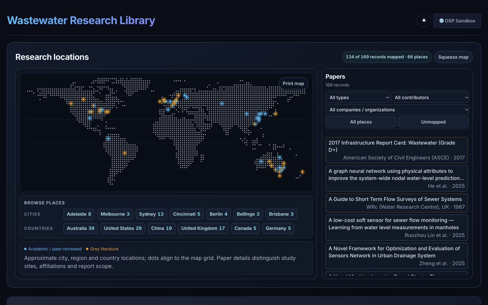
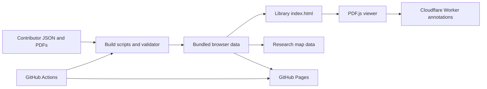

<a id="readme-top"></a>

<div align="center">

<h1>Wastewater Research Library</h1>

<p><b>A static browser library for the Capstone PG-S2-22 team's wastewater sensor papers, compiled reviews and utility reports.</b><br/>
58 research papers, 5 compiled reviews, 1 team paper and 111 grey-literature reports, with shared notes and a generated research map.</p>

<p>
  <a href="https://siddhu-123.github.io/waste_water_network_sensor-papers/index.html"><b>Live demo</b></a> ·
  <a href="#features">Features</a> ·
  <a href="#quick-start">Quick start</a> ·
  <a href="#how-it-works">How it works</a>
</p>

    

</div>

<p align="center"></p>

Open [`index.html`](./index.html), or use the shared library link above. A direct Vercel deployment is also available at https://waste-water-network-sensor-papers-two.vercel.app/.

## Highlights

- **Data outside the HTML.** All paper records come from contributor JSON; `index.html` contains no hardcoded paper data.
- **A real PDF reading experience.** Vendored PDF.js 3.11.174 renders a reconstructed table of contents with publisher page labels and click-to-jump navigation.
- **Shared annotations.** Rectangular highlights and draggable sticker notes are stored as normalized coordinates in a Cloudflare Worker with KV.
- **Checked in CI.** A Python validator runs locally and in GitHub Actions before the site is published to GitHub Pages.
- **A generated research map.** Study locations are extracted from paper PDFs in CI, with reviewed overrides kept in `data/geography/reviewed.json`.

## Features

### Library

- **Nested filters.** Topic, user and category filters with a squeeze/expand toggle.
- **8-step summaries.** Shared summaries in `summaries.json`, plus contributor profile cards.
- **Three shelves.** Team and contributor compiled papers, plus a grey-literature tab.
- **Duplicate warnings.** DOI first, then normalized title, first author and year; suspected duplicates stay visible with the earlier paper ID and uploader, and duplicate identities are validation warnings, not errors.

### Reader and annotations

- **PDF.js viewer.** Table of contents, true publisher page labels and click-to-jump navigation.
- **Shared notes.** Rectangular highlights and draggable sticker notes, stored as normalized coordinates.

### Data and CI

- **Research map.** Generated from paper PDFs in CI, with reviewed overrides.
- **Repository validator.** Python checks run locally and in GitHub Actions.

## How it works



All paper records are loaded from contributor JSON files; `index.html` contains no hardcoded paper data. Every push to `main` runs `.github/workflows/validate.yml`: it tests ingestion, regenerates geography and browser data, validates both and publishes the site, while pull requests run the same steps without deploying. `annotation-config.js` sets the API base in this order: `?api=` query, saved localStorage override, Cloudflare Worker, then same origin, and overrides are accepted only for the live Worker or a local server. Shared saves use the Cloudflare Worker; Vercel remains a separate store, not a synced copy, keeping one JSON object per paper in Blob under `annotations/paper-<paperId>.json`, checking the Blob revision ETag on save and requiring `BLOB_READ_WRITE_TOKEN`, with GitHub OAuth optional there. On `file://` pages shared saving is disabled, and the viewer can load a committed JSON fallback from `annotations/` and download a local backup; see [the backend review](docs/cloudflare-backend-review.md) for the transfer status and open items. For PDFs without embedded bookmarks, the viewer reconstructs headings from text lines using baseline clustering and font metrics, then shows publisher page labels, such as Roman front matter followed by printed page numbers, in the table of contents and toolbar.

## Progress

| Area / Feature | Status | Notes |
|---|---|---|
| Viewer, filters and compiled-paper shelves | ✅ Done | Paper data is loaded from contributor JSON, not hardcoded in HTML |
| PDF viewer, summaries and shared annotations | ✅ Done | Cloudflare Worker is the default annotation store |
| Grey-literature catalogue and research map | ✅ Done | Map data is regenerated on pushes to `main` |
| Validator and GitHub Actions build | ✅ Done | Tests, geography build, validation and Pages deploy |
| Atomic writes and auth parity on Cloudflare | ⏳ Planned | Review recommends D1 conditional updates; GitHub OAuth routes are not ported |
| Retire the Vercel store after another comparison | ⏳ Planned | Vercel remains deployed with its original data |

## Quick start

Prerequisites: Python 3. No package install is needed to view the library.

1. From this directory, start a static server:

   ```sh
   python3 -m http.server 8000
   ```

2. Open http://localhost:8000 and use the topic, user and category filters.
3. Click **PDF + Notes** beside a paper to open the PDF viewer.
4. Run the validator before committing:

   ```sh
   python3 scripts/validate_repo.py
   ```

GitHub Actions runs the same validator on pushes and pull requests, then publishes the site to GitHub Pages from `main`.

## Project structure

<details>
<summary><b>Project structure</b></summary>

```text
.
├── index.html              # Main viewer with nested filters
├── pdf-viewer.html         # PDF.js viewer with highlights and notes
├── view.html, r/           # Additional view pages
├── css/, js/               # Stylesheets and viewer modules
├── vendor/pdfjs-3.11.174/  # Bundled PDF.js
├── contributors/           # Manifest, templates and per-member paper folders
├── summaries.json          # Shared 8-step paper summaries
├── annotations/            # Optional committed annotation fallback
├── api/, server/           # Vercel OAuth and annotation routes
├── cloudflare-backend/     # Cloudflare Worker annotation API
├── data/geography/         # Reviewed mappings and gazetteer data
├── scripts/                # Data builders, validators and transfer tools
└── docs/                   # Backend review and location-automation notes
```

</details>

## Tech stack

| Layer | Technology |
|---|---|
| Frontend | Vanilla JavaScript and modular CSS; no frontend build step |
| PDF | PDF.js 3.11.174, vendored under `vendor/` |
| Scripts | Python 3 for bundled data, geography data and repository validation |
| Shared notes | Cloudflare Worker plus KV by default (`cloudflare-backend/`) |
| Alternate store | Vercel Blob and the GitHub OAuth routes remain as a separate store |
| Hosting and CI | GitHub Pages, built and deployed by GitHub Actions |

## Adding content

Use the exact contributor names in [`contributors/manifest.json`](./contributors/manifest.json). Do not rename a contributor folder or change a registered name without updating the manifest.

### Research paper

1. Open your own `contributors/<your-slug>/papers.json`, copying [`contributors/_template/papers.json`](./contributors/_template/papers.json) if needed.
2. Pick a numeric ID unique across all contributors and put the PDF in your `papers/` folder.
3. Add a record with `pages`, `size` (for example `"1.2 MB"`) and a `pdfUrl` beginning `./contributors/`.
4. Add the matching 8-step entry to [`summaries.json`](./summaries.json) under the same numeric ID.
5. Add the canonical DOI when one exists, and set `assignedTo`, `topic` and `filterCategory` in both metadata locations so nested filters stay correct.

The 8 steps are citation, intro, aims and research methods, scope, usefulness, limitations, conclusions and reflection.

### Compiled paper

The single team paper lives at the `contributors/` root: [`team_compiled_paper.pdf`](./contributors/team_compiled_paper.pdf) with metadata in `team_compiled_paper.json`, registered as `teamCompiledPaper`. The team report PDF is registered as `teamProjectReport`.

For an individual or co-authored review (2 or 3 teammates):

1. Put the PDF in `contributors/<your-slug>/compiled-papers/` named `<first-author-first-name>_<published-year>_<paper-name>.pdf`, with underscores between words.
2. Add an entry to the `compiledPapers` array in your `papers.json` with `id`, `title`, `topic`, `filterCategory`, `assignedTo`, `description`, `pages`, `size` and `pdfUrl`.
3. For co-authors, use an array of names or a comma-separated string. The paper appears under either contributor's filter and lists all co-authors.

### Grey literature

Grey literature covers utility reports, overflow case studies, design standards, regulator guidelines, sensor manuals and drainage master plans.

1. Put the PDF in `contributors/<your-slug>/grey/` named `GL_<Year>_<Org>_<ShortTitle>.pdf`. A web-only document can use `url` with `pdfUrl` set to `"#"` or omitted.
2. Make sure your manifest entry defines `greyLiteratureFile` (and optionally `findingsDocument`); add it if missing. Copy the record template from [`contributors/_template/grey-literature.json`](./contributors/_template/grey-literature.json).
3. Add the record to the contributor's `grey-literature.json`. `id`, `title` and `organization` are required; optional fields are `year`, `category`, `summary`, `assignedTo`, `pdfUrl`, `url`, `pages`, `size`, `keyTakeaways` and an 8-key `steps` object. The viewer matches `organization` to utility badge colours and renders all 8 steps when present, otherwise it falls back to `summary` and `keyTakeaways`.
4. Update `totalCount` at the top of that file.
5. Validate, serve and check the **Grey Literature & Utility Reports** tab for badges, filters, PDF links and modals:

   ```sh
   python3 scripts/validate_repo.py
   python3 -m http.server 8000
   ```

## Before committing

- JSON is valid; PDF paths beginning `./` exist; research and compiled-paper IDs are unique.
- DOIs are valid; papers without a DOI are checked for repeated title, first author and year.
- Contributor names match the manifest; co-author lists use registered names.
- `topic`, `filterCategory` and `assignedTo` are correct; grey-literature records have `title` and `organization`.
- Manifest `greyLiteratureFile` and `findingsDocument` paths resolve, and grey-literature `pdfUrl` paths point to existing PDFs.

Run `python3 scripts/validate_repo.py`.

## Research map

Adding or changing contributor metadata and PDFs on `main` runs the GitHub Actions build before publishing. It extracts study locations, regenerates map data and validates the library; ambiguous, missing or unreadable locations stay unmapped with a reason, and compiled reviews are excluded from map display. Human corrections belong in `data/geography/reviewed.json`. Details: [automatic location processing](docs/research-location-automation.md) and the [GeoNames notice](data/geography/NOTICE.md).

## Credits

Compiled by the Capstone PG-S2-22 team: Satya Siddhartha, Abraham, Ashis Jose, Rijoy John and Wimukthi. The team paper and project report are listed in `contributors/manifest.json`.

<p align="right"><a href="#readme-top">Back to top ↑</a></p>
